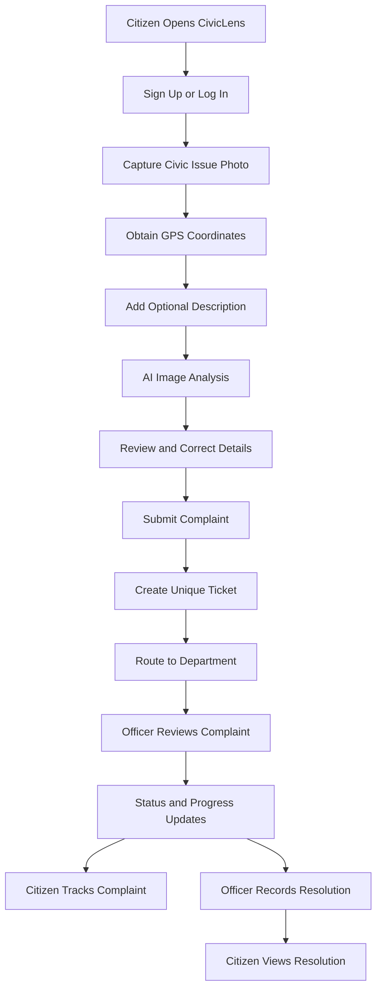
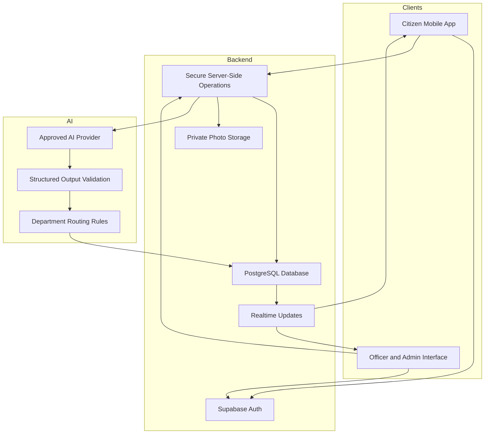

# CivicLens 🌍
### Turn a Photo Into Action. Make Your City Better.

**CivicLens** is an AI-powered civic complaint platform that helps citizens report urban issues with a photo, automatically captured GPS coordinates, and a simple description. It transforms everyday civic problems into structured, trackable service requests and gives municipal officials a centralized dashboard to manage complaints and prioritize repairs.

Built for the **Meta Global AI Developer Hackathon** under the **Build for Your World** theme.

> **Our vision:** Make civic reporting effortless, municipal workflows transparent, and communities better places to live.

---

## 📌 The Problem

A pothole on your daily commute. A broken streetlight outside your home. An overflowing public bin that nobody seems to address.

Reporting these problems can be frustrating. Citizens often don't know which department to contact, must manually describe locations, and have little visibility into what happens after submitting a complaint.

Meanwhile, municipal teams may receive incomplete reports, duplicate complaints, and unstructured information that makes prioritization difficult.

**CivicLens bridges this gap between citizens and city services.**

## 💡 The Solution

CivicLens turns a simple photograph into an actionable municipal complaint.

📸 **Capture** — Photograph a civic issue directly through the mobile app.

📍 **Locate** — Capture the device's current GPS coordinates with the citizen's permission.

🧠 **Understand** — Use multimodal AI to analyze the image, suggest an issue category, assess severity, and generate a structured complaint.

🗂️ **Route** — Recommend the appropriate municipal department using AI-assisted classification and validated routing rules.

🎫 **Track** — Generate a unique complaint reference and follow status changes through a ticket-style timeline.

🏛️ **Resolve** — Enable authorized municipal officers to manage complaints, publish updates, and record resolutions.

The goal is simple: **less friction for citizens, better information for officials, and greater transparency for everyone.**

---

## ✨ Key Features

### 📱 Citizen Experience

- **Secure Authentication** — Sign up and log in to access personal complaints.
- **Camera-First Reporting** — Capture a new photograph directly through the application.
- **GPS-Based Location** — Attach current coordinates after requesting location permission.
- **AI-Assisted Classification** — Generate suggested categories, complaint titles, summaries, and severity levels.
- **Review Before Submission** — Let citizens review and correct AI-generated information.
- **Unique Complaint Tickets** — Receive a reference for every successfully submitted complaint.
- **Complaint Tracking** — View current status, department assignment, and complete status history.
- **Live Updates** — Receive complaint status changes without manually refreshing the screen.
- **Resolution History** — Review official updates and resolution notes.

### 🏢 Municipal Officer Experience

- Centralized complaint queue.
- Department-based complaint assignment.
- Complaint filtering and search.
- Access to photographs, descriptions, and location information.
- Status transitions and citizen-visible progress updates.
- Internal notes separated from public updates.
- Complaint reassignment and resolution records.

### 📊 Administrative Dashboard

- Overview of submitted, pending, active, and resolved complaints.
- Complaint distribution by department and category.
- Recent complaint activity.
- Workload visibility across departments.
- Basic operational analytics to help identify recurring civic issues.

### 🤖 AI-Powered Intelligence

- Image-based civic issue understanding.
- Structured complaint generation.
- Suggested department routing.
- Severity recommendations with uncertainty handling.
- Validated structured model outputs.
- Manual fallback when AI inference is unavailable.

AI outputs are recommendations, not verified facts. Citizens and authorized officials retain control over corrections and final decisions.

---

## 🔄 How It Works



### Example: Reporting a Pothole

1. A resident photographs a pothole on a Stockholm street.
2. CivicLens obtains the resident's current GPS coordinates with permission.
3. AI suggests **Road Damage**, generates a complaint summary, and recommends the Roads Department.
4. The resident reviews the details and submits the complaint.
5. CivicLens generates a complaint reference and assigns the ticket according to validated routing rules.
6. An authorized officer reviews the ticket and updates its status to **In Progress**.
7. The resident sees the update in the complaint timeline.
8. The officer records the resolution, and the citizen can view the completed history.

---

## 🛠️ Technology Stack

| Layer | Technology | Purpose |
|---|---|---|
| Mobile application | Expo + React Native | Cross-platform Android and iOS experience |
| Programming language | TypeScript | Type-safe application development |
| Navigation | Expo Router | Screen navigation and routing |
| Backend platform | Supabase | Managed backend infrastructure |
| Database | PostgreSQL via Supabase | Complaints, users, departments, and status history |
| Authentication | Supabase Auth | User authentication and session management |
| File storage | Supabase Storage | Complaint photographs |
| Realtime | Supabase Realtime | Live complaint status synchronization |
| Access control | PostgreSQL RLS | Enforce data access permissions |
| AI inference | Meta AI models / Meta Model API, subject to access | Multimodal understanding and structured recommendations |
| Optional inference provider | Baseten, subject to access and model availability | Hosted AI model inference |

The technology stack describes the intended architecture. Provider availability, API access, and integrations must be verified during implementation.

---

## 🏗️ High-Level Architecture



### Architecture Principles

- Keep AI-provider credentials out of the mobile application.
- Enforce permissions at the database and trusted server-side boundaries.
- Store complaint photographs in private storage.
- Separate AI suggestions from citizen-confirmed information and official decisions.
- Use deterministic routing rules to validate department assignments.
- Maintain a timestamped audit trail for important complaint updates.
- Handle AI failures without losing complaint data or blocking manual reporting.

---

## 🏙️ Supported Complaint Categories

The initial prototype is designed around common urban issues.

| Category | Suggested Department |
|---|---|
| Potholes and road damage | Roads Department |
| Broken streetlights | Street Lighting |
| Illegal dumping and overflowing bins | Waste Management |
| Blocked sidewalks and accessibility issues | Public Works / Accessibility |
| Traffic infrastructure problems | Traffic Department |
| Uncertain or unsupported issues | General Municipal Review |

Department names and routing rules are configurable examples for the prototype, not claims of an official integration with Stockholm's municipal systems.

---

## 🔐 Security and Privacy

CivicLens is designed around responsible handling of citizen data.

- **Authentication:** Secure account management through Supabase Auth.
- **Row-Level Security:** Citizens can access only their permitted records; officers and administrators receive role-specific access.
- **Role Protection:** Privileged roles cannot be self-assigned by ordinary users.
- **Private Media:** Complaint photographs are stored in private storage with controlled access.
- **Secret Management:** AI-provider secrets and service-role credentials remain server-side.
- **Location Privacy:** GPS coordinates are collected only for complaint creation, with clear permission handling.
- **Data Minimization:** Collect only information needed to submit and manage a complaint.
- **Auditability:** Record important status transitions and administrative actions.
- **AI Transparency:** Let users review AI-generated suggestions and correct errors.

These are implementation requirements and must be verified through testing before the application is considered production-ready.

---

## 🚀 Getting Started

The following steps describe the intended development setup. Exact dependencies and scripts should be confirmed against the repository as implementation progresses.

### Prerequisites

- Node.js LTS.
- npm.
- Expo Go or an Android/iOS development environment.
- A Supabase project.
- AI-provider access and credentials, when available.

### 1. Clone the Repository

```bash
git clone <YOUR_REPOSITORY_URL>
cd CivicLens
```

Replace the placeholder with the actual repository URL.

### 2. Install Dependencies

```bash
npm install
```

If the repository uses a monorepo or separate application directories, follow the relevant package instructions instead.

### 3. Configure Supabase

Create a Supabase project and configure:

- Authentication.
- PostgreSQL schema and migrations.
- Row-Level Security policies.
- Private photo storage.
- Realtime publication and subscriptions.

Create a local environment configuration based on the variables required by the application.

Example:

```env
EXPO_PUBLIC_SUPABASE_URL=your_supabase_project_url
EXPO_PUBLIC_SUPABASE_ANON_KEY=your_supabase_publishable_key
```

Use only the appropriate public client key in the mobile application. Never put a Supabase service-role key or AI-provider secret in an `EXPO_PUBLIC_` variable.

### 4. Configure AI Inference

Configure the selected, supported AI provider through a trusted server-side environment.

The implementation should verify credentials, supported models, request formats, response schemas, and error handling before enabling AI-powered complaint analysis.

If credentials or credits are unavailable, use a clearly identified mock response or manual categorization fallback during development.

### 5. Start the Application

For a standard Expo project:

```bash
npx expo start
```

Follow the Expo development server instructions to open the application on a supported device or simulator.

**Note:** The exact setup commands may change depending on the final repository structure and implemented scripts.

---

## 🌱 Future Possibilities

- Multilingual reporting and localized interfaces.
- Map-based civic issue discovery.
- Advisory duplicate complaint detection.
- Public dashboards for aggregated, privacy-preserving civic insights.
- Automated summaries of recurring infrastructure problems.
- Configurable municipal workflows and service-level targets.
- Additional AI providers and optimized inference deployments.
- Integration with municipal systems where authorized APIs are available.

---

## 🌍 Impact

CivicLens aims to make civic participation easier and complaint handling more transparent.

By connecting citizen observations with structured reports and trackable workflows, it creates an opportunity for residents and municipal teams to collaborate more effectively on everyday urban problems.

**A better city starts with a report that doesn't get lost.**

---

## 🧪 Project Status

CivicLens is being developed as a hackathon prototype. Features, AI integrations, security controls, and municipal workflows should be considered implemented only after they have been built and tested.

## 🤝 Contributing

Contributions, feedback, and ideas are welcome.

Potential areas include:
- Mobile UX and accessibility.
- AI classification and structured outputs.
- Supabase schema and access control.
- Complaint workflow design.
- Testing and reliability.
- Civic technology research.

Please open an issue to discuss a significant change before submitting a pull request.

## 📄 License

The project license has not yet been specified. Add a `LICENSE` file before distributing the project under an open-source license.

---

**CivicLens — Turn a Photo Into Action. Make Your City Better.**
