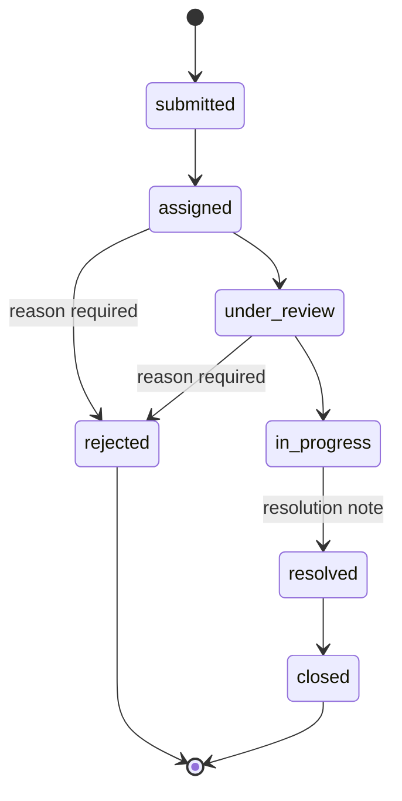

# CivicLens — User Journey & Screen Flow

> **Deliverable 2 of 9.** Documentation only.
> **Visual reference:** `REFERENCE/CivicLens Civic Complaint App Flow.png` (the 10-screen mockup that anchors this flow).
> **Related:** [PRD](./01-prd.md) · [Architecture](./03-technical-architecture.md) · [Edge cases are in §Edge-Case Handling below and cross-referenced from the Test Plan].

This document defines the screen inventory, navigation structure, entry points, per-screen states, transitions, permissions, loading/empty/error behavior, and edge cases.

---

## 1. Navigation model

### 1.1 Citizen app (Expo Router)
A tab navigator wraps the authenticated area; auth screens sit outside it.

```
app/
  (auth)/
    welcome          → Screen 1  Welcome / Login
    register         → Screen 2  Registration
    forgot-password  → Forgot-password
  (tabs)/
    home             → Screen 3  Home Dashboard         [tab: Home]
    track            → Screen 8  My Complaints          [tab: Track]
    notifications    → Notifications list               [tab: Notifications]
    profile          → Profile / settings / logout      [tab: Profile]
  complaint/
    capture          → Screen 4  Capture Photo
    location         → Screen 5  Obtain Location
    describe         → Screen 6  Describe the Issue (AI)
    review           → Screen 7  Review & Submit
    confirmation     → Submission confirmation
    [id]             → Screen 9  Complaint Details
    [id]/timeline    → Screen 10 Live Status Timeline
```

The four bottom-tab icons (Home, Track, Notifications, Profile) match the mockup.

### 1.2 Officer/Admin web dashboard (separate web target — see Architecture §Officer/Admin surface)
```
/dashboard     → Screen 11 Municipal Dashboard
/complaints    → Screen 12 Complaint Queue
/complaints/:id→ Screen 13 Complaint Management
/departments   → (admin) department & officer management
/analytics     → (admin) trends
/settings      → (admin) config (SLA, roles)
```

### 1.3 High-level journey

```mermaid
flowchart TD
  A[Welcome / Login] -->|new user| B[Register]
  A -->|existing| C[Home]
  B --> C
  C -->|Register New Complaint| D[Capture Photo]
  D --> E[Obtain Location]
  E --> F[Describe + AI analysis]
  F --> G[Review & Submit]
  G -->|submit confirmed| H[Confirmation + reference]
  H --> I[Complaint Details]
  C -->|Track My Complaints| J[My Complaints]
  J --> I
  I --> K[Live Status Timeline]
  subgraph Officer/Admin (web)
    L[Municipal Dashboard] --> M[Complaint Queue] --> N[Complaint Management]
  end
  N -. status change (Realtime) .-> K
```

---

## 2. Flow A — Authentication

### Screen 1 — Welcome / Login
**Purpose:** entry point and sign-in. Mockup: CivicLens logo, Stockholm skyline, Login / Sign Up buttons. 🟡 Since the app is India-first, use a neutral city illustration instead of a specific skyline.

- **Content:** brand mark + name; tagline *"Turn a photo into action. Make your city better."*; email field; password field (show/hide); **Login** button; link to **Register**; **Forgot password?** link.
- **"Continue as Guest":** ✅ **removed** (owner decision, 2026-10-27). Only verified users can use the app.
- **States:** idle; validating; loading (button spinner, inputs disabled); invalid credentials (inline error, no field clearing); **email not verified** ("Please verify your email" + "Resend verification email"); network error (retry affordance); rate-limited (friendly message).
- **Transitions:** success → Home (Screen 3); Register link → Screen 2; Forgot → forgot-password.

### Screen 2 — Registration
**Purpose:** create an account via Supabase Auth. Mockup: "Create your account" with name, email, phone, password.

- **Required:** full name, email, password, and location in three cascading dropdowns: **Country** (default India) → **State / UT** (that country's states) → **City** (that state's active cities). Each dropdown is searchable; changing a parent clears the ones below it, and a child stays disabled until its parent is chosen. **Optional:** phone (C-3 — do not require; `+91` prefix shown when India is selected).
- **City not in list:** P1 "Can't find your city? Request it" form. For the MVP, the seeded list covers major Indian cities.
- **Why city:** it connects the citizen to that city's municipal departments and sets their Home screen context (FR-AUTH-009).
- **Also:** password confirmation (recommended); **explicit checkbox** to accept Privacy Policy & Terms (FR-AUTH-006); links to both documents.
- **Behavior:** on submit → create auth user (name, city, phone passed as metadata) → a DB trigger creates the `profiles` row with role `citizen` → Supabase sends the verification email. The user **can't log in until they verify** (FR-AUTH-007). Verification is one-time.
- **States:** idle; validating (email format, password strength, passwords match, city chosen, terms accepted); loading; **duplicate email** error; weak-password error; network error.
- **Transitions:** success → "Check your inbox" screen (with Resend) → Login after the user clicks the verification link.

### Forgot-password
- Email field → send reset link via Supabase Auth → "check your inbox" confirmation. States: idle/loading/sent/error. Never reveal whether an email exists (anti-enumeration): always show the same confirmation.

### Screen 3 — Home Dashboard
**Purpose:** hub for action + recent activity. Mockup: "Good morning, Yash", Stockholm location chip, "Report an issue" card with **Register New Complaint**, "Track your complaint" with an ID search, quick categories (Roads, Lighting, Waste, Others), bottom tabs. 🟡 Quick categories become the 6 groups (Roads & Traffic, Water & Drainage, Electricity, Cleanliness, Parks & Trees, Other); tapping one starts a complaint with that group preselected for the picker.

- **Content:** greeting with name; city chip (the user's home city, e.g. Stockholm); primary **Register New Complaint** action; **Track** (by reference) with recent complaints list and status summaries; quick-category shortcuts; profile + notifications entry.
- **States:** loading (skeletons for recent list); **empty** (no complaints yet → friendly prompt to file the first one); error (retry); content.
- **Transitions:** Register → Screen 4; a recent item → Screen 9; Track search → Screen 9 (by reference); Notifications tab → list; Profile tab → profile.

---

## 3. Flow B — Register a new complaint

### Screen 4 — Capture Photo
**Purpose:** capture a **new** photo (camera-first). Mockup shows a captured street photo with a **Retake** control and a 3-step indicator (Photo · Details · Review).

- **Permission:** request **camera** permission at point of use with a one-line rationale ("We use your camera to capture the issue you're reporting").
- **Behavior:** open native camera → capture → show **preview** → allow **Retake** or **Use photo**. Image is held locally until submission (uploaded later).
- **Hard rule:** never silently swap in a gallery image (FR-COMPLAINT-005). Gallery is P2.
- **States:** permission-prompt; permission-denied (explain + "Open Settings" deep link + cannot proceed); camera-active; preview; error (camera unavailable → message + retry).
- **Transitions:** Use photo → Screen 5. Back → Home with a discard confirmation if a photo exists.

### Screen 5 — Obtain Location
**Purpose:** capture current GPS. Mockup folds this into the photo step ("Location detected (GPS) · Lat/Long · Accuracy ~5 m").

- **Permission:** request **location (when-in-use)** with rationale ("We attach your current location so the city can find the issue").
- **Behavior:** acquire current coordinates; store **lat, long, accuracy**; reverse-geocode them on the device and show the citizen a **readable address** ("Near Shivajinagar Bus Stop, FC Road · Shivajinagar, Pune 411005") with accuracy. Raw coordinates are not shown to the citizen (FR-LOCATION-003).
- **Geocoder:** 🟡 the phone's built-in reverse geocoder via Expo Location (on Android it uses the system geocoder; no API key or cost; verify behavior and accuracy on Day 1). The address is approximate and labeled as such ("Near …"). It's never generated by the AI. Provide **Retry** to re-acquire. Location is captured **only here** (no continuous tracking, FR-LOCATION-007).
- **Required to submit** (A-5 / FR-LOCATION-006); the UI states this plainly.
- **States:** requesting; acquiring (spinner); acquired (show address + accuracy + a "looks wrong? Retry" affordance); **address unavailable** (geocoder failed or offline: "Location captured · address not available", city name if known, can still continue); **denied** (explain requirement + Settings deep link + cannot proceed); **services disabled** (prompt to enable); **timeout** (retry); **low accuracy** (warn, allow retry, allow proceed with a stored accuracy flag). Never fabricate coordinates (FR-LOCATION-005).
- **Transitions:** acquired → Screen 6.

### Screen 6 — Describe the Issue (AI analysis)
**Purpose:** optional description + AI-assisted structured analysis. Mockup: captured photo, auto-GPS, "Add description (optional)" with a 0/500 counter, **Next**.

- **Content shown:** captured photo; detected location; **optional** description field (≤ 500 chars); AI analysis status area.
- **AI attempts to extract:** category; short title; structured summary; suggested severity; confidence/uncertainty (when supported); suggested department; supporting visual observations. (Full contract in the [AI Spec](./05-ai-specification.md).)
- **Categories (MVP):** 21 categories in 6 groups, from the `categories` table (full list in [DB §3.0c](./04-database-design.md)):
  - **Roads & Traffic:** potholes & road damage · traffic signals & signs · broken/blocked footpath · encroachment
  - **Water & Drainage:** blocked drain / sewage · open manhole · waterlogging · water pipe leakage · no/dirty water supply
  - **Electricity & Lighting:** streetlight · electrical hazard · power supply
  - **Cleanliness & Health:** garbage · illegal dumping · public toilet · mosquito breeding · dead animal · stray animals
  - **Parks & Trees:** fallen tree · park damage
  - **Other / not sure**
- **Manual picker** (fallback or correction): two steps, group first, then category, each with an icon and the example hint.
- **Rules:** AI output is a **recommendation**, never auto-verified; precise GPS is **not** sent to the AI (OQ-7); ambiguous/irrelevant/insufficient image → ask the citizen to clarify instead of inventing (FR-AI-005).
- **States:** analyzing (non-blocking spinner; the citizen can still edit the description); suggestion-ready; **AI failed/timed out** → show a clear notice + **manual categorization** controls (FR-AI-003) so the flow continues; retry available.
- **Transitions:** Next → Screen 7.

### Screen 7 — Review & Submit
**Purpose:** confirm and correct before creating the ticket. Mockup: "Review & Submit" with Issue type (Road Damage), auto-detected location, description, **Submit Complaint**.

- **Content:** photo; title; category; description; GPS; suggested severity; suggested department; **destination city** ("Will be sent to: Pune Municipal Corporation"); AI uncertainty where relevant.
- **City notices:** GPS in a different city than the profile → "You're in Mumbai, so this goes to Mumbai's municipal office." GPS outside every known city → "This location is outside Pune city limits. It'll be sent to Pune for review." All AI-derived fields are **editable** (FR-AI-004 keeps the original AI suggestion stored separately).
- **On Submit:** validate required fields (FR-SUBMIT-001) → upload image to private bucket → create complaint (status `submitted`, timestamp) → assign reference `CL-YYYY-NNNNNN` (FR-SUBMIT-004) → deterministic department routing (FR-ROUTING-001) → store AI suggestion separately → write initial status-history row → return.
- **Idempotency:** the Submit button disables on first tap and the request carries a client-generated idempotency key so retries don't duplicate (FR-SUBMIT-005). Success is shown **only after** backend confirmation (FR-SUBMIT-006).
- **States:** editable; submitting (progress: uploading → creating); success → Confirmation; **partial failure** (upload ok but create failed, or create ok but response lost) → see Edge Cases EC-11/EC-12; validation errors inline.

### Confirmation
- Big success check (mockup style), the **complaint reference**, assigned department, and CTAs: **View details** (→ Screen 9) and **Done** (→ Home). The reference is shown only on confirmed creation.

---

## 4. Flow C — Track complaint

### Screen 8 — My Complaints
Mockup basis: list of complaint cards with status chips.
- **Each row:** reference, title, photo thumbnail, category, submission date, current status (colored chip), assigned department.
- **Controls:** filter by status; sort by latest activity (FR-TRACK-003).
- **States:** loading (skeleton rows); **empty** ("No complaints yet"); error (retry); content. Scoped to the signed-in citizen only (RLS).

### Screen 9 — Complaint Details
Mockup: "Complaint Details" with photo, status chip (In Progress), reference `CL-2024-0012`, title, location, department, submitted time, description, photos.
- **Content:** reference; photo(s); description; location; category & severity; assigned department; current status; submission timestamp; status history (link to timeline); citizen-visible updates; resolution notes when resolved. **No internal notes** (FR-TRACK-005).
- **States:** loading; content; error; realtime-updating (subtle indicator when a live update arrives).

### Screen 10 — Live Status Timeline
Mockup: "Live Updates" vertical timeline — Submitted → Assigned → In Progress → Update (Latest) → Resolution (Pending), with timestamps and a "You'll get notified…" footer.

**Lifecycle statuses:** `submitted` → `assigned` → `under_review` → `in_progress` → `resolved` → `closed`; plus `rejected` (requires a reason).

**Valid transitions & who may perform them:**

| From → To | Actor | Notes |
|-----------|-------|-------|
| `submitted → assigned` | System on routing; admin/officer may confirm | Auto on create (department assigned) |
| `assigned → under_review` | Officer (that dept) | Officer acknowledges |
| `under_review → in_progress` | Officer | Work started |
| `in_progress → resolved` | Officer | Requires resolution note |
| `resolved → closed` | Officer/Admin (or auto after N days — P2) | Final |
| `assigned/under_review → rejected` | Officer/Admin | **Mandatory reason** |
| any non-terminal → `assigned` (reassign) | Admin | Reassignment, audited |
| `rejected/closed` → (reopen) | Admin only | P1/P2; audited |



**On every status change:** update DB → write timestamped `complaint_status_history` row (actor + optional citizen-visible update) → create in-app notification → push to connected clients via Realtime. Internal notes are stored in `complaint_comments` with `visibility = internal` and are **never** sent to citizen clients.

**Realtime behavior:** citizen Details/Timeline subscribe to their complaint's changes; on disconnect, auto-reconnect; a manual pull-to-refresh is always available as fallback (FR-REALTIME-002).

---

## 5. Officer & Admin screens (web)

### Screen 11 — Municipal Dashboard
Mockup: "City Service Dashboard" with Total/Resolved/In Progress/Pending cards, "Complaints by Department" donut, "Recent Complaints" list, left nav (Dashboard, Complaints, Departments, Analytics, Settings), admin profile top-right.
- **Cards:** total; newly submitted; under review; in progress; resolved; **overdue** (SLA: Critical 24 h, High 3 d, Medium 7 d, Low 14 d); complaints by department; recent activity; frequently reported categories; recent complaints list.
- **Rule:** metrics computed from **real stored data**; seeded demo data is labeled as demo (a visible "Demo data" badge in demo builds).

### Screen 12 — Complaint Queue
- Each row shows the SLA due time and a red **Overdue** chip when past due; "Outside city limits" flag when set.
- Search by reference/title; filter by category/status/severity/department/overdue; sort by submission time/priority/due time; open details; assign/reassign department; assign officer; update status; add citizen-visible update; add internal note; record rejection reason & resolution details.
- Officer sees **only their department**; admin sees all (RLS-enforced).

### Screen 13 — Complaint Management
- Review evidence (photo via signed URL, description, location, AI suggestion); correct category/department; acknowledge; set under review / in progress; publish progress updates; resolve with a resolution note; request more info (P1).
- Role-based permissions + **audit logging for every privileged action** (FR-SEC-005).

---

## 6. Screen-state matrix (summary)

Every data screen implements these states explicitly (NFR-ERR-001):

| Screen | loading | empty | error | permission-denied | offline | realtime-updating |
|--------|:---:|:---:|:---:|:---:|:---:|:---:|
| Home | ✓ | ✓ | ✓ | — | ✓ | — |
| Capture Photo | — | — | ✓ | ✓ (camera) | — | — |
| Obtain Location | ✓ | — | ✓ | ✓ (location) | ✓ | — |
| Describe (AI) | ✓ | — | ✓ (AI) | — | ✓ | — |
| Review & Submit | ✓ (submitting) | — | ✓ | — | ✓ | — |
| My Complaints | ✓ | ✓ | ✓ | — | ✓ | ✓ |
| Complaint Details | ✓ | — | ✓ | — | ✓ | ✓ |
| Timeline | ✓ | — | ✓ | — | ✓ | ✓ |
| Dashboard/Queue | ✓ | ✓ | ✓ | ✓ (role) | ✓ | ✓ |

---

## 7. Edge-case handling

For each case: **UI response**, **recovery action**, **backend/consistency requirement**. These IDs are referenced by the Test Plan.

| ID | Case | UI response | Recovery | Backend/consistency |
|----|------|-------------|----------|---------------------|
| EC-01 | Camera permission denied | Explain why camera is needed; cannot proceed | "Open Settings" deep link; re-check on return | No complaint created |
| EC-02 | Location permission denied | Explain location is required to submit | Settings deep link; Retry | No submit without valid GPS |
| EC-03 | GPS unavailable/inaccurate | Show "couldn't get a precise fix"; show accuracy | Retry; optionally proceed with low-accuracy flag | Store accuracy; never fabricate coords |
| EC-04 | App closed mid-submission | On relaunch, detect in-flight draft | Offer to resume or discard draft | Idempotency key prevents dup on resume |
| EC-05 | Network loss during upload | Progress shows failure | Retry upload; keep local image | Orphaned upload cleaned up or reused by key |
| EC-06 | Image upload failure | Clear error on Review | Retry; do not advance | No complaint row without a stored photo path |
| EC-07 | AI provider timeout | Non-blocking notice on Describe | Retry or switch to manual categorization | Flow proceeds via fallback (FR-AI-003) |
| EC-08 | Invalid AI response | Treated as AI-unavailable | Manual categorization | Never store unvalidated AI output as verified |
| EC-09 | Repeated submit taps | Button disabled after first tap | — | Idempotency key dedupes server-side |
| EC-10 | Duplicate network retries | Spinner persists | — | Same idempotency key → single row |
| EC-11 | Create ok but confirmation lost | On retry/relaunch, resolve by key | Show the already-created complaint | No second row; reconcile by key/reference |
| EC-12 | Upload ok but create failed | Error; offer retry | Retry create reuses uploaded object | No dangling complaint; object reused or GC'd |
| EC-13 | Realtime disconnect | Subtle "reconnecting" hint | Auto-reconnect; manual refresh | Pull fetch returns authoritative state |
| EC-14 | Concurrent officer edits | Second save sees stale version | Reload latest; re-apply | Optimistic concurrency (updated_at/version check) |
| EC-15 | Unauthorized dept access | 403 / "not available" | — | RLS blocks at DB layer |
| EC-16 | Reassignment | Timeline shows reassignment event | — | Audited; department FK stays valid |
| EC-17 | Rejected complaint | Status `rejected` + reason shown to citizen | Citizen may file a new complaint | Reason mandatory; recorded in history |
| EC-18 | Account deletion | Confirm + explain effects | Process deletion/anonymization | Personal data removed/anonymized per policy |
| EC-19 | Unsupported/irrelevant photo | AI/manual flags "Other / uncertain"; ask to clarify | Retake or proceed as Other | Routes to General Municipal Review |
| EC-20 | Submission before backend confirm | Never show success prematurely | — | Success UI gated on confirmed insert (FR-SUBMIT-006) |
