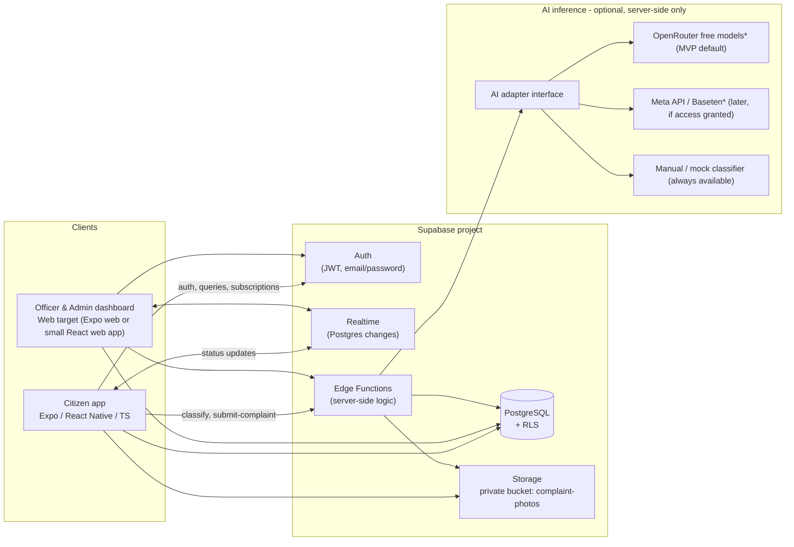
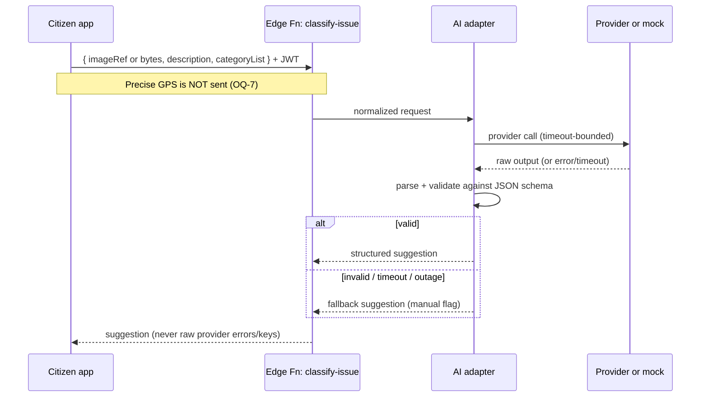
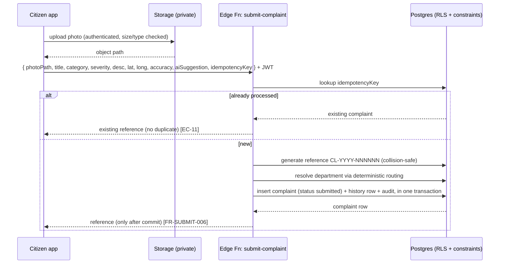
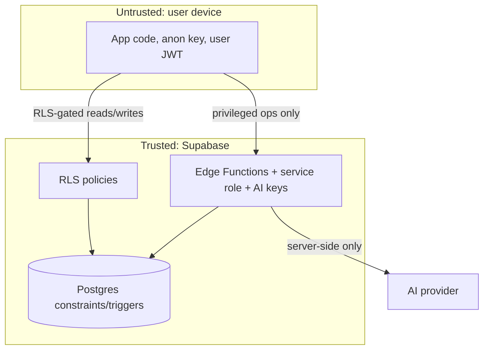

# CivicLens — Technical Architecture

> **Deliverable 3 of 9.** Documentation only. No services have been provisioned; no code written.
> **Confirmed stack:** Expo + React Native + TypeScript + Expo Router · Supabase (Postgres, Auth, Storage, Realtime, RLS, Edge Functions) · provider-agnostic AI adapter (server-side only).
> **Related:** [PRD](./01-prd.md) · [Database](./04-database-design.md) · [AI Spec](./05-ai-specification.md) · [Security](./06-security-and-privacy.md).

---

## 1. Component overview



\* MVP uses **OpenRouter free models** (owner decision). Which free models accept images, and their rate limits, must be verified before coding. The mock classifier keeps the flow working if OpenRouter is down or rate-limited.

### 1.1 Responsibilities

| Component | Responsibility | Does **not** do |
|-----------|----------------|-----------------|
| Citizen app | Capture photo & GPS, render flows/states, authenticated reads via RLS, subscribe to Realtime, call Edge Functions for privileged ops | Call AI providers directly; hold service-role or AI secrets; perform routing math it can't be trusted on |
| Officer/Admin web | Triage queue, dashboards from real data, status updates via Edge Function, Realtime | Bypass RLS; expose secrets |
| Supabase Auth | Identity, JWT issuance, password reset, email verification | Authorize business rules (RLS/Edge Functions do) |
| PostgreSQL + RLS | System of record; per-row access control; constraints that keep status/history consistent | Trust client-asserted roles |
| Storage | Private photo objects; signed-URL access | Public exposure of photos |
| Realtime | Broadcast row changes to subscribed, authorized clients | Deliver internal notes to citizens (filtered by RLS/row visibility) |
| Edge Functions | Secret-bearing & trust-sensitive operations: AI classification call, complaint submission (reference generation, routing, idempotency), privileged status transitions, signed-URL minting, audit writes | Return provider secrets or raw provider errors to clients |
| AI adapter | Normalize provider request/response; validate schema; fall back to manual/mock | Decide final routing (app rules do) |

---

## 2. Why Edge Functions (and not a separate Node backend)

The brief forbids adding a mandatory Node backend without justification. Supabase **Edge Functions** satisfy every server-side need here:

- They are the only place AI-provider and service-role secrets live (never in the mobile bundle — FR-SEC-004).
- They perform operations the client must not be trusted to do atomically: **reference generation**, **deterministic routing**, **idempotent submission**, **privileged status transitions with history + audit**, and **signed-URL minting**.
- They keep the deployment surface minimal for a small hackathon team.

🟡 **PROPOSED:** All privileged writes go through Edge Functions; plain authenticated **reads** go directly to Postgres under RLS (simpler, cheaper, realtime-friendly). This split is the "simplest secure architecture" the brief asks for.

---

## 3. Key data flows

### 3.1 AI classification (Describe screen)



Suggestion is a **recommendation** held in app state; it is persisted (separately from verified fields) only at submission. Contract in the [AI Spec](./05-ai-specification.md).

### 3.2 Complaint submission (Review & Submit)



Idempotency, reference generation, routing, and the status/history/audit write are **atomic on the server** (see DB design for the generation and consistency mechanisms).

### 3.3 Officer status change → citizen realtime

```mermaid
sequenceDiagram
  participant Off as Officer web
  participant EF as Edge Fn: update-status
  participant DB as Postgres
  participant RT as Realtime
  participant Cit as Citizen app
  Off->>EF: { complaintId, toStatus, citizenVisibleUpdate?, reason?, expectedVersion } + JWT
  EF->>DB: authorize (dept + role), validate transition, optimistic version check
  EF->>DB: update status + insert history + notification + audit (one txn)
  DB-->>RT: row change events
  RT-->>Cit: push update (authorized rows only)
  Cit->>Cit: timeline/details update without manual refresh
```

Internal notes are written to `complaint_comments(visibility='internal')`; RLS ensures citizen subscriptions never receive them.

---

## 4. Authentication & authorization boundaries

- **AuthN:** Supabase Auth (email/password, JWT). The client attaches the JWT to all requests.
- **AuthZ (defense in depth):**
  1. **RLS on every table** — the primary gate for reads and direct writes.
  2. **Edge Functions** — re-check role/department before privileged writes; use the service role **only** inside the function.
  3. **DB constraints/triggers** — enforce invariants (valid transitions, history consistency) regardless of caller.
- **Role source of truth:** `profiles.role` (`citizen` | `officer` | `admin`) and `profiles.department_id`. Clients can never write their own role (RLS forbids; role changes go through an admin-only path). See [Security doc](./06-security-and-privacy.md).

---

## 5. Officer/Admin surface decision

✅ **DECIDED (solo builder, 8-day schedule): Option A — Expo Router web build of the same project.** One codebase is the only realistic choice for one developer. Officer/admin routes are web-only and hidden on native. Options considered:

| Option | Pros | Cons | Recommendation |
|--------|------|------|----------------|
| **A. Expo Router web build** of the same project | One codebase, shared types & Supabase client | RN-for-web layout quirks; dashboard is desktop-dense | Good if the team wants a single repo |
| **B. Small separate React (Vite) web app** | Native web layout freedom for dense tables/charts | Second project to maintain; duplicate some setup | Good if dashboard UX is a priority |

Either way: **shared TypeScript types** for DB rows, the **same Supabase JS client**, and the **same Edge Functions**. Do not assume RN components behave identically on web (brief §6). Charts (donut, counts) use a standard web charting lib in Option B or an RN-web-compatible one in Option A.

---

## 6. Error handling & provider-failure behavior

| Failure | Behavior |
|---------|----------|
| AI timeout/outage/invalid JSON | Adapter returns fallback; app shows manual categorization; no raw provider error reaches the client |
| Provider A down | Adapter tries configured next provider or the mock (config-driven order) |
| Storage upload fail | Client retries; no complaint row is created without a stored photo path |
| Edge Function 5xx | Client shows a friendly error + retry; idempotency key makes retry safe |
| Realtime drop | Auto-reconnect + manual refresh fallback |
| DB constraint violation (e.g., invalid transition) | Edge Function maps to a clean 4xx with a safe message; no stack traces to client |

**Rule:** clients receive sanitized errors only. Prompts, keys, provider payloads, and stack traces are never surfaced (AI Spec §7, Security §9).

---

## 7. Environment & configuration

Secrets live only where noted. **None** of the server-only values may appear in the Expo bundle or client env.

| Name | Where | Secret? | Purpose |
|------|-------|:------:|---------|
| `SUPABASE_URL` | client + server | no | Project URL |
| `SUPABASE_ANON_KEY` | client | no (public, RLS-gated) | Client access under RLS |
| `SUPABASE_SERVICE_ROLE_KEY` | **Edge Functions only** | **yes** | Privileged server writes |
| `AI_PROVIDER` | Edge Functions | no | Selects adapter (`openrouter` default / `meta` / `baseten` / `mock`) |
| `AI_PROVIDER_API_KEY` | **Edge Functions only** | **yes** | OpenRouter API key for the MVP |
| `AI_PROVIDER_ENDPOINT` | Edge Functions | no* | Provider base URL (verify before use) |
| `AI_MODEL` | Edge Functions | no | Primary model ID (a free vision-capable model, verified) |
| `AI_MODEL_FALLBACKS` | Edge Functions | no | Comma-separated backup model IDs, tried in order before the mock |
| `AI_TIMEOUT_MS` | Edge Functions | no | Classification timeout (NFR-PERF-003) |
| `DEMO_MODE` | both | no | Enables the "Demo data" badge. Email verification is **always** enforced. |
| — | — | — | SLA targets live in the `sla_policies` table (admin-editable), not in env |

\* Endpoints/model names must be **verified against real provider docs** before coding (brief forbids inventing them). Until verified, `AI_PROVIDER=mock`.

Expo public env vars (`EXPO_PUBLIC_*`) may hold only non-secret values (`SUPABASE_URL`, `SUPABASE_ANON_KEY`).

### 7.1 Env files (owner decision: all API connections in env)

Two files, both git-ignored, each with a committed `.env.example` that has names only:

```bash
# .env  (app — bundled into the APK, so NO secrets here)
EXPO_PUBLIC_SUPABASE_URL=
EXPO_PUBLIC_SUPABASE_ANON_KEY=
EXPO_PUBLIC_DEMO_MODE=true
```

```bash
# supabase/functions/.env  (Edge Functions only — secrets live here)
SUPABASE_SERVICE_ROLE_KEY=
AI_PROVIDER=openrouter            # openrouter | meta | baseten | mock
AI_PROVIDER_ENDPOINT=             # verify from OpenRouter docs
AI_PROVIDER_API_KEY=
AI_MODEL=                         # a verified free vision model ID
AI_MODEL_FALLBACKS=               # comma-separated backups
AI_TIMEOUT_MS=12000
```

Switching providers means changing these values only. For the deployed project, the same values are set as Supabase Edge Function secrets (verify the current Supabase CLI command, e.g. `supabase secrets set --env-file`, before use). Anything in `.env` with the `EXPO_PUBLIC_` prefix ends up in the APK and can be read by anyone, which is why provider keys never go there.

### 7.2 Android build

- Development: Expo Go on an Android phone (verify on Day 1 that camera, location, and secure storage work there; otherwise use a development build).
- Submission: an installable **APK** via EAS Build (verify the current profile setting for APK output before use).

---

## 8. Realtime synchronization behavior

- Citizen Details/Timeline subscribe to changes for **their** complaint (RLS scopes the payload).
- Officer/Admin queues subscribe to their authorized rows.
- On reconnect, the client refetches the authoritative row to avoid missed events (NFR-RT-002).
- Internal notes never ride citizen subscriptions (row visibility enforced by RLS).

---

## 9. Trust boundaries (summary)



Anything on the device is untrusted. Secrets, routing authority, reference generation, and privileged transitions live behind the trust boundary.
