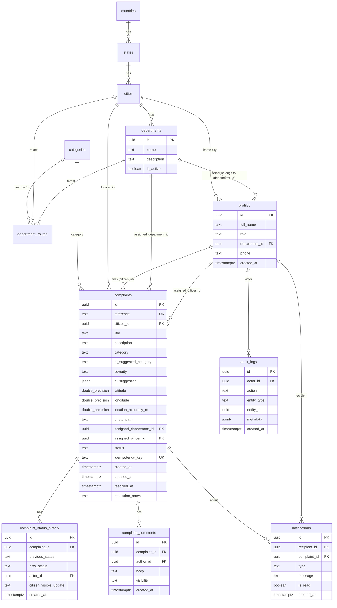

# CivicLens — Database Design (Supabase / PostgreSQL)

> **Deliverable 4 of 9.** Documentation only — this is a **proposed** schema. No migrations have been run and no database provisioned. SQL below is illustrative reference, not executed code.
> **Related:** [Architecture](./03-technical-architecture.md) · [Security & RLS](./06-security-and-privacy.md) · [AI Spec](./05-ai-specification.md).

---

## 1. Entity-relationship overview



---

## 2. Enumerated types (proposed)

Use Postgres `enum`s (or `text` + `check`) to keep values valid.

| Enum | Values |
|------|--------|
| `user_role` | `citizen`, `officer`, `admin` |
| ~~`complaint_category`~~ | **Replaced by the `categories` table (§3.0c)** so new issue types can be added as data, without a migration |
| `complaint_severity` | `low`, `medium`, `high`, `critical` |
| `complaint_status` | `submitted`, `assigned`, `under_review`, `in_progress`, `resolved`, `closed`, `rejected` |
| `comment_visibility` | `public`, `internal` |
| `notification_type` | `status_change`, `assignment`, `comment`, `resolution`, `system` |

---

## 3. Tables, columns, keys, constraints, indexes

> Types shown are the intended Postgres types. PK = primary key, FK = foreign key, UK = unique.

### 3.0a `countries` (added 2026-10-27)

| Column | Type | Constraints |
|--------|------|-------------|
| `code` | `text` | PK, ISO 3166-1 alpha-2 (`IN`, `SE`) |
| `name` | `text` | `not null` |
| `phone_prefix` | `text` | `not null` (`+91`, `+46`) |
| `emergency_number` | `text` | `not null` (`112` for both India and Sweden; shown on Critical severity) |
| `is_active` | `boolean` | `not null default true` |

### 3.0b `states` (added 2026-10-27)
Sign-up picks **Country → State → City** (owner decision). "State" also covers union territories in India and regions/counties elsewhere (e.g. Stockholm County).

| Column | Type | Constraints |
|--------|------|-------------|
| `id` | `uuid` | PK |
| `country_code` | `text` | `not null`, FK → countries(code) |
| `name` | `text` | `not null`; **unique(country_code, name)** |
| `type` | `text` | `not null`, check in (`state`, `union_territory`, `region`) |
| `is_active` | `boolean` | `not null default true` |

Seed: all Indian states and union territories; Stockholm County for Sweden.

### 3.0c `categories` (added 2026-10-27)
One row per issue type, grouped for the UI. The AI prompt, the JSON Schema enum, the manual picker, and routing all read from this table, so adding a category is one insert.

| Column | Type | Constraints |
|--------|------|-------------|
| `code` | `text` | PK (e.g. `drainage`) |
| `label` | `text` | `not null` (UI text) |
| `group_code` | `text` | `not null` (e.g. `water_drainage`) |
| `group_label` | `text` | `not null` (e.g. "Water & Drainage") |
| `examples` | `text` | `not null`; short hint shown in the picker and sent to the AI |
| `department_key` | `text` | `not null`; which standard department handles it (see below) |
| `severity_hint` | `complaint_severity` | nullable; a starting point for the AI/fallback, never forced |
| `sort_order` | `integer` | `not null` |
| `is_active` | `boolean` | `not null default true` |

**Category catalog (seed):**

| Group | Code | Label | Examples | Department key |
|-------|------|-------|----------|----------------|
| Roads & Traffic | `road_damage` | Potholes & road damage | Potholes, broken or sunken road | `roads` |
| Roads & Traffic | `traffic_signal` | Traffic signals & signs | Signal not working, missing sign, faded zebra crossing | `traffic` |
| Roads & Traffic | `footpath` | Broken or blocked footpath | Broken tiles, missing ramp, blocked walkway | `public_works` |
| Roads & Traffic | `encroachment` | Encroachment | Illegal stalls or structures on road/footpath | `public_works` |
| Water & Drainage | `drainage` | Blocked drain / sewage overflow | Choked drain, sewage on road | `drainage` |
| Water & Drainage | `open_manhole` | Open or broken manhole | Missing or broken cover | `drainage` |
| Water & Drainage | `waterlogging` | Waterlogging / flooding | Water standing on road after rain | `drainage` |
| Water & Drainage | `water_leakage` | Water pipe leakage | Burst pipeline, leaking valve | `water_supply` |
| Water & Drainage | `water_supply` | No / dirty water supply | No water, contaminated water | `water_supply` |
| Electricity & Lighting | `streetlight` | Streetlight not working | Dark, flickering, or broken streetlight | `electrical` |
| Electricity & Lighting | `electrical_hazard` | Electrical hazard | Hanging or exposed wires, damaged pole, sparking box | `electrical` |
| Electricity & Lighting | `power_supply` | Power supply issue | Area power cut, transformer problem | `electrical` |
| Cleanliness & Health | `garbage` | Garbage & overflowing bins | Uncollected garbage, overflowing bin | `solid_waste` |
| Cleanliness & Health | `illegal_dumping` | Illegal dumping / debris | Construction debris, dumped waste | `solid_waste` |
| Cleanliness & Health | `public_toilet` | Public toilet issue | Dirty, broken, or locked public toilet | `public_health` |
| Cleanliness & Health | `mosquito_breeding` | Stagnant water / mosquito breeding | Stagnant water in open plots, tyres, containers | `public_health` |
| Cleanliness & Health | `dead_animal` | Dead animal | Carcass on road or in public place | `public_health` |
| Cleanliness & Health | `stray_animals` | Stray animals | Stray dogs or cattle causing trouble | `animal_control` |
| Parks & Trees | `fallen_tree` | Fallen or dangerous tree | Fallen tree, hanging branch | `garden` |
| Parks & Trees | `park_maintenance` | Park / playground damage | Broken bench or swing, unmaintained park | `garden` |
| Other | `other` | Other / not sure | Anything else | `general` |

**Standard departments** (created for every city by one seed function):

| `department_key` | Department name |
|------------------|-----------------|
| `roads` | Roads & Engineering |
| `traffic` | Traffic |
| `public_works` | Public Works & Encroachment |
| `drainage` | Drainage & Sewerage |
| `water_supply` | Water Supply |
| `electrical` | Street Lighting & Electrical |
| `solid_waste` | Solid Waste Management |
| `public_health` | Public Health & Sanitation |
| `animal_control` | Animal Control |
| `garden` | Garden & Tree Department |
| `general` | General Municipal Review |

Notes:
- In many Indian cities, power supply is handled by the electricity distribution company (DISCOM), not the municipal corporation. `power_supply` routes to the municipal Electrical department in this simulated workflow; a real rollout would forward it.
- Whatever doesn't fit lands in `other` → General Municipal Review, where an officer re-categorizes it. Recurring "other" issues show which category to add next (admin adds a row; P1 admin UI, MVP via SQL).

### 3.0 `cities` (added 2026-10-27)
Citizens pick a country, then a home city, at sign-up. Complaints must reach their city's departments.

| Column | Type | Constraints |
|--------|------|-------------|
| `id` | `uuid` | PK |
| `country_code` | `text` | `not null`, FK → countries(code) |
| `state_id` | `uuid` | `not null`, FK → states(id) (e.g. Maharashtra) |
| `name` | `text` | `not null`; **unique(state_id, name)** (Indian city names repeat across states) |
| `timezone` | `text` | `not null` (`Asia/Kolkata`, `Europe/Stockholm`) |
| `center_lat`, `center_lng` | `double precision` | `not null` |
| `radius_km` | `double precision` | `not null`, > 0 (🟡 default 20; larger for metros) |
| `is_active` | `boolean` | `not null default true` |

Index: `index(state_id, is_active, name)` for the State → City picker.

**Why center + radius instead of a bounding box:** it's one point and one number per city, so seeding a few dozen Indian cities is quick. It's an approximation; exact municipal boundaries (PostGIS polygons) are P2.

**Complaint city rule (GPS + profile, owner decision):**

1. Find active cities whose center is within `radius_km` of the complaint GPS (haversine distance). Pick the nearest.
2. Match found → `complaints.city_id` = that city, `city_source = 'gps'`. If it differs from the profile city, the Review screen says so.
3. No match → `complaints.city_id` = the citizen's profile city, `city_source = 'profile'`, `outside_city_limits = true`. The Review screen warns, and officers see the flag.
4. Never block submission because of the city.

This runs inside `submit-complaint` (server-side). The client also runs it for display on Review, but the server result is authoritative.

### 3.1 `profiles`
Links 1:1 to `auth.users`. Role lives here (the single source of truth).

| Column | Type | Constraints |
|--------|------|-------------|
| `id` | `uuid` | PK, **FK → auth.users(id) ON DELETE CASCADE** |
| `full_name` | `text` | `not null`, length check 1–120 |
| `role` | `user_role` | `not null default 'citizen'` |
| `department_id` | `uuid` | FK → departments(id); `null` unless officer |
| `city_id` | `uuid` | `not null`, FK → cities(id); chosen at sign-up. For officers it must equal their department's city (trigger) |
| `phone` | `text` | nullable (optional, C-3) |
| `created_at` | `timestamptz` | `not null default now()` |

Constraints/indexes: `index(role)`, `index(department_id)`. **Check:** `department_id` must be non-null when `role='officer'` (enforced by trigger or app rule; see §6). Clients cannot update `role`/`department_id` (RLS — see Security).

### 3.2 `departments`

| Column | Type | Constraints |
|--------|------|-------------|
| `id` | `uuid` | PK default `gen_random_uuid()` |
| `city_id` | `uuid` | `not null`, FK → cities(id) |
| `department_key` | `text` | `not null`; **unique(city_id, department_key)**; matches `categories.department_key` (§3.0c) |
| `name` | `text` | `not null`; **unique(city_id, name)** |
| `description` | `text` | nullable |
| `is_active` | `boolean` | `not null default true` |
| `is_general_review` | `boolean` | `not null default false`; exactly one `true` per city (partial unique index) |

Seeded (demo) departments **per city**: the 11 standard departments in §3.0c. The `general` one has `is_general_review = true`.

### 3.2a `department_routes` (added 2026-10-27, optional override)
Default routing needs no per-city rows: category → `department_key` → that city's department with the same key. This table only exists for cities that organize things differently (e.g. one city's Roads department also handles footpaths).

| Column | Type | Constraints |
|--------|------|-------------|
| `city_id` | `uuid` | FK → cities(id) |
| `category_code` | `text` | `not null`, FK → categories(code) |
| `department_id` | `uuid` | FK → departments(id); trigger checks it belongs to `city_id` |

PK: `(city_id, category_code)`. Empty in the MVP seed.

### 3.3 `complaints`

| Column | Type | Constraints |
|--------|------|-------------|
| `id` | `uuid` | PK default `gen_random_uuid()` |
| `reference` | `text` | **UK**, format `CL-YYYY-NNNNNN` (see §4) |
| `citizen_id` | `uuid` | `not null`, FK → profiles(id) |
| `city_id` | `uuid` | `not null`, FK → cities(id); set server-side by the city rule (§3.0) |
| `city_source` | `text` | `not null`, check in (`gps`, `profile`) |
| `outside_city_limits` | `boolean` | `not null default false` |
| `title` | `text` | `not null`, length 1–140 |
| `description` | `text` | nullable, length ≤ 2000 |
| `category` | `text` | `not null`, FK → categories(code) (final, verified) |
| `ai_suggested_category` | `text` | nullable, FK → categories(code) (recommendation only) |
| `severity` | `complaint_severity` | `not null default 'medium'` |
| `ai_suggestion` | `jsonb` | nullable — full validated AI payload (title/summary/severity/dept/observations/uncertainty) |
| `latitude` | `double precision` | `not null`, check -90..90 |
| `longitude` | `double precision` | `not null`, check -180..180 |
| `location_accuracy_m` | `double precision` | nullable, check ≥ 0 |
| `address_text` | `text` | nullable, ≤ 300 chars; readable address from the device's reverse geocoder (display only, approximate) |
| `locality` | `text` | nullable, ≤ 120 chars; area/neighbourhood (e.g. "Shivajinagar"), used in queue rows |
| `postal_code` | `text` | nullable, ≤ 12 chars |

The address fields are **display-only** and never used for routing. City routing still uses coordinates (§3.0), so a wrong or missing address can't send a complaint to the wrong office.
| `photo_path` | `text` | `not null` (object key in private bucket) |
| `assigned_department_id` | `uuid` | `not null`, FK → departments(id) |
| `assigned_officer_id` | `uuid` | nullable, FK → profiles(id) |
| `status` | `complaint_status` | `not null default 'submitted'` |
| `idempotency_key` | `text` | **UK** (per-submission client key) |
| `created_at` | `timestamptz` | `not null default now()` |
| `updated_at` | `timestamptz` | `not null default now()` (optimistic concurrency) |
| `resolved_at` | `timestamptz` | nullable; set when status → `resolved` |
| `resolution_notes` | `text` | nullable; **required** when status → `resolved` (app/trigger rule) |

Indexes:
- `unique(reference)`, `unique(idempotency_key)`
- `index(citizen_id)` — My Complaints
- `index(assigned_department_id, status)` — officer queue filtering
- `index(status)` — dashboard counts
- `index(city_id, status)` — per-city admin dashboard
- `index(category)` — "by category" analytics
- `index(created_at)` — sort by submission
- Optional: `index using gist` on a `geography(Point)` column if PostGIS is enabled (P2, for proximity/duplicate detection). **Not required for MVP.**

Checks:
- `resolved_at` is null unless `status in ('resolved','closed')`.
- `latitude`/`longitude` range checks (above).

### 3.4 `complaint_status_history`
Append-only audit of status transitions.

| Column | Type | Constraints |
|--------|------|-------------|
| `id` | `uuid` | PK default `gen_random_uuid()` |
| `complaint_id` | `uuid` | `not null`, FK → complaints(id) ON DELETE CASCADE |
| `previous_status` | `complaint_status` | nullable (null on first/submitted row) |
| `new_status` | `complaint_status` | `not null` |
| `actor_id` | `uuid` | `not null`, FK → profiles(id) |
| `citizen_visible_update` | `text` | nullable (shown to citizen when present) |
| `created_at` | `timestamptz` | `not null default now()` |

Indexes: `index(complaint_id, created_at)`. **Rule:** rows are never updated/deleted (append-only); the complaint's `status` must always equal the `new_status` of its latest history row (§6).

### 3.5 `complaint_comments`

| Column | Type | Constraints |
|--------|------|-------------|
| `id` | `uuid` | PK |
| `complaint_id` | `uuid` | `not null`, FK → complaints(id) ON DELETE CASCADE |
| `author_id` | `uuid` | `not null`, FK → profiles(id) |
| `body` | `text` | `not null`, length 1–2000 |
| `visibility` | `comment_visibility` | `not null` (`public` or `internal`) |
| `created_at` | `timestamptz` | `not null default now()` |

Indexes: `index(complaint_id, created_at)`, `index(complaint_id, visibility)`. **Internal** comments are readable only by officers of the complaint's department and admins (RLS).

### 3.6 `notifications`

| Column | Type | Constraints |
|--------|------|-------------|
| `id` | `uuid` | PK |
| `recipient_id` | `uuid` | `not null`, FK → profiles(id) |
| `complaint_id` | `uuid` | nullable, FK → complaints(id) ON DELETE CASCADE |
| `type` | `notification_type` | `not null` |
| `message` | `text` | `not null` |
| `is_read` | `boolean` | `not null default false` |
| `created_at` | `timestamptz` | `not null default now()` |

Indexes: `index(recipient_id, is_read, created_at)`.

### 3.7 `audit_logs`
Append-only record of privileged actions.

| Column | Type | Constraints |
|--------|------|-------------|
| `id` | `uuid` | PK |
| `actor_id` | `uuid` | `not null`, FK → profiles(id) |
| `action` | `text` | `not null` (e.g., `status_change`, `reassign`, `role_change`) |
| `entity_type` | `text` | `not null` (e.g., `complaint`, `profile`, `department`) |
| `entity_id` | `uuid` | `not null` |
| `metadata` | `jsonb` | nullable (before/after, reason, etc.; no secrets/PII beyond necessity) |
| `created_at` | `timestamptz` | `not null default now()` |

Indexes: `index(entity_type, entity_id, created_at)`, `index(actor_id, created_at)`. Writable only by Edge Functions (service role); no client write/update/delete.

---

### 3.8 `sla_policies` (added 2026-10-27)

| Column | Type | Constraints |
|--------|------|-------------|
| `severity` | `complaint_severity` | PK |
| `target_hours` | `integer` | `not null`, > 0 |

Seed (owner decision): `critical` 24 · `high` 72 · `medium` 168 · `low` 336. Global for the MVP; per-city overrides are P2. Admin-editable.

**Overdue calculation** (a view, e.g. `complaints_with_sla`, so nothing extra has to be kept in sync):

```sql
-- Illustrative. due_at follows the CURRENT severity, measured from submission time.
select c.*,
       c.created_at + make_interval(hours => s.target_hours) as due_at,
       (c.status not in ('resolved','closed','rejected')
        and now() > c.created_at + make_interval(hours => s.target_hours)) as is_overdue
from complaints c
join sla_policies s on s.severity = c.severity;
```

The view must use `security_invoker = true` so the caller's RLS still applies (verify the option on the Supabase Postgres version in use).

## 4. Complaint reference generation (collision-free)

**Format:** `CL-YYYY-NNNNNN` — `YYYY` = year of creation (UTC), `NNNNNN` = zero-padded per-year sequence.

🟡 **PROPOSED mechanism** (server-side, inside the `submit-complaint` Edge Function transaction):

- A `reference_counters(year int PK, last_seq bigint)` table. In one transaction: `INSERT ... ON CONFLICT (year) DO UPDATE SET last_seq = reference_counters.last_seq + 1 RETURNING last_seq;` then format `CL-${year}-${pad(last_seq,6)}`.
- `complaints.reference` has a **unique** constraint as a second line of defense; on the astronomically unlikely clash, the function retries.
- This is atomic and gap-tolerant (gaps are fine; uniqueness is what matters). A pure `sequence` works too but doesn't reset per year; the counter table keeps the human-readable year segment meaningful.

---

## 5. Idempotent submission (no duplicate tickets)

- The client generates an `idempotencyKey` (UUID) when the Review screen loads and sends it with Submit.
- `complaints.idempotency_key` is **unique**. The `submit-complaint` function first looks up the key; if a row exists it returns that row's reference (EC-11), otherwise it inserts.
- Because the key is created once per complaint draft, repeated taps/retries (EC-09/EC-10/EC-12) converge on one row.

---

## 6. Status ↔ history consistency

Enforced server-side so the two can never diverge (NFR-REL-002):

- All status changes go through the `update-status` Edge Function (and the initial insert through `submit-complaint`), which, **in a single transaction**: validates the transition against the allowed-transition table, updates `complaints.status` + `updated_at` (+ `resolved_at`/`resolution_notes` when resolving), inserts the `complaint_status_history` row, inserts a `notifications` row, and writes an `audit_logs` row.
- A **BEFORE UPDATE trigger** on `complaints` rejects status transitions that aren't in the allowed set, regardless of caller — defense in depth if a direct update is ever attempted.
- A **check/trigger** guarantees the latest history `new_status` equals `complaints.status`. Optimistic concurrency uses `updated_at`/an `expected_version` to catch concurrent officer edits (EC-14).

Allowed transitions (also in Screen Flow §Screen 10):

```
submitted  → assigned
assigned   → under_review | rejected
under_review → in_progress | rejected
in_progress → resolved
resolved   → closed
(admin)    → reassign to assigned ; reopen rejected/closed  [audited]
```

---

## 7. Department assignment validity

- `complaints.assigned_department_id` is **not null** and FK-constrained to `departments(id)`; routing always resolves to a valid, `is_active` department, defaulting to **General Municipal Review** (FR-ROUTING-002).
- Routing is computed in `submit-complaint` from `(complaints.city_id, final verified category)`, never from the raw AI field:
  1. A `department_routes` override for that city + category, if one exists.
  2. Otherwise the city's department whose `department_key` = `categories.department_key`.
  3. If that's missing or inactive, the city's General Municipal Review department.
- A trigger checks that the assigned department's `city_id` equals the complaint's `city_id`, so a complaint can never land in another city's department.
- Reassignment (admin) updates the FK and writes history + audit.

---

## 8. Private image access

- Photos live in a **private** Storage bucket `complaint-photos`; `complaints.photo_path` stores the object key only.
- Access paths: (a) citizens read their own via RLS-backed Storage policy tied to `citizen_id`; (b) officers/admins read via a **short-lived signed URL** minted by an Edge Function after an authorization check. No public URLs. (Details in [Security doc](./06-security-and-privacy.md).)

---

## 9. How indexes support expected queries

| Query | Supporting index |
|-------|------------------|
| Citizen "My Complaints" (by citizen, recent) | `index(citizen_id)` + `index(created_at)` |
| Officer queue (dept + status filter/sort) | `index(assigned_department_id, status)` |
| Dashboard status counts | `index(status)` |
| "By category" analytics | `index(category)` |
| Lookup by reference (track by ID) | `unique(reference)` |
| Idempotent submit lookup | `unique(idempotency_key)` |
| Timeline fetch | `index(complaint_id, created_at)` on history |
| Unread notifications | `index(recipient_id, is_read, created_at)` |

---

## 10. Realtime requirements

Enable Realtime (Postgres changes) publication for: `complaints` (status/assignment changes), `complaint_status_history` (timeline rows), `complaint_comments` (public comments), and `notifications`. RLS applies to realtime payloads, so citizens only receive their own rows and never `internal` comments.

---

## 11. Seed data (demo, labeled)

Seed for the demo (flagged by `DEMO_MODE`): countries India and Sweden; a list of major Indian cities (🟡 proposed: state/UT capitals plus the largest metros, roughly 40–50 rows) with center and radius, plus Stockholm; for **every** seeded city, all Indian states/UTs (plus Stockholm County); the 21-row `categories` catalog; the 11 standard departments created by one seed function (so routing works in any city); `sla_policies`; officers for the city you test in; one admin; realistic complaints in that city across categories/statuses (matching the dashboard mockup's distribution: Roads, Lighting, Waste, Traffic, Other). All seed rows are clearly demo data and surfaced with a "Demo data" badge in the dashboard.
